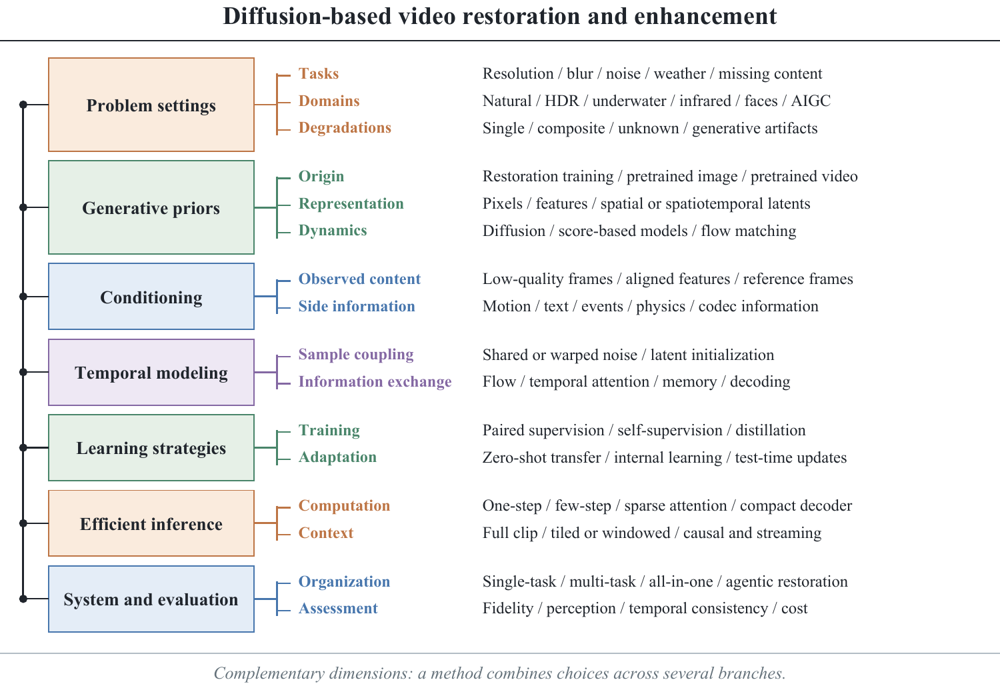

# A Comprehensive Survey of Diffusion-based Video Restoration and Enhancement

[Paper](paper.pdf) · [LaTeX](paper.tex) · [Bibliography](refs.bib) · [Method matrix](research/method_matrix.csv) · [Literature-list coverage](research/spreadsheet_coverage.csv)

An English survey of diffusion-based restoration and enhancement of observed videos, organized around **fidelity, perceptual quality, and temporal consistency**. The current revision contains **117 references, six figures, and eight comparison tables**. Literature coverage is updated through **17 November 2026**.



## Organization

1. Introduction
2. Background and Taxonomy
3. Methodology: generative priors and conditioning, temporal modeling, learning and restoration systems, efficient inference
4. Restoration Tasks and Applications
5. Datasets and Evaluation
6. Challenges and Future Directions
7. Conclusion

The task discussion includes spatial and space-time super-resolution, generic restoration, deblurring, weather, low light, HDR, underwater video, infrared/turbulence, faces, compression, film restoration, inpainting, and generated-video enhancement.

## Latest revision

- Replaced Fig. 1 with matched published spatial results and temporal profiles from Upscale-A-Video and StableVSR; replaced Fig. 4 with their actual method architectures. Sources and CC BY 4.0 credits are in [figure attribution](figures/ATTRIBUTION.md).
- Replaced Fig. 6 with all 30 published quality-metric SRCC pairs from Herb et al., comparing within-source and overall correlations. Removed the redundant five-row metric table. The plotted values are reported results, not new experiments.
- Reconciled all 81 records in the supplementary literature list: 47 were already covered and 34 were added after primary-source verification.
- Expanded HDR, arbitrary-scale and space-time VSR, compressed-video enhancement, internal/zero-shot restoration, and recent acceleration methods.
- Reorganized the manuscript using the structural approach of the [all-in-one restoration survey](https://arxiv.org/abs/2410.15067) and [diffusion image restoration survey](https://arxiv.org/abs/2308.09388). Their artwork and prose are not reproduced.
- Removed retrieval, evidence-boundary, and manuscript-preparation sections from the paper. Supporting records remain in `research/`.
- Restored the original IEEE template running header.

## Files

| Path | Contents |
|---|---|
| `paper.pdf` | Compiled survey |
| `paper.tex`, `sections/` | Editable manuscript |
| `refs.bib` | 117 cited bibliographic entries |
| `figures/` | Six publication figures and previews |
| `figures/ATTRIBUTION.md`, `figures/source_assets/` | Reused image sources, credits, transformations and hashes |
| `scripts/make_figures.py`, `scripts/make_evidence_figures.py` | Reproducible figure generation |
| `research/metric_study_table1.csv` | Complete published Table I values used for Fig. 6 |
| `research/metric_study_evidence.md` | Data extraction and raw-data cross-check notes |
| `research/method_matrix.csv` | 93 method and system records |
| `research/spreadsheet_coverage.csv` | Row-level mapping of all 81 literature-list entries |
| `research/source_audit.json` | 118 source records, including one uncited structural reference |
| `research/revision_coverage.json` | Revision coverage summary |
| `research/audit_notes.md` | Technical corrections and bibliographic provenance |
| `research/validation.json` | Build and visual-verification record |
| `benchmark/` | Proposed evaluation configuration and empty result template |

## Build

Requires TeX Live with IEEEtran, latexmk, BibTeX, and the packages listed in `paper.tex`.

```sh
latexmk -pdf -interaction=nonstopmode -halt-on-error -outdir=build paper.tex
```

`powershell -File scripts/build.ps1` or `make paper` also copies the compiled file to `paper.pdf`. Figure PDFs are included; Python is only needed to redraw them.

```sh
python -m pip install -r scripts/requirements-figures.txt
python scripts/make_figures.py
python scripts/validate_sources.py
```

## Supporting research records

Bibliographic entries use primary proceedings/publisher exports or verified metadata. Google Scholar exports were unavailable behind a verification page; no Scholar export is claimed. Preprints remain identified as preprints. The source ledger records evidence locators and corrections, while raw downloaded papers and the supplied files are not redistributed.

The benchmark is a proposal. Figs. 1 and 4 reproduce attributed published examples and architectures; Fig. 6 plots published data; Figs. 2, 3 and 5 are explanatory diagrams. The survey reports published findings, including the QoMEX 2026 metric study; it does not present new model experiments. The supplied author information is retained.

Literature verification and synthesis drew on [Academic Research Skills](https://github.com/Imbad0202/academic-research-skills). Research-process and AI-assistance records are kept in the supporting notes rather than in the technical body of the manuscript.
